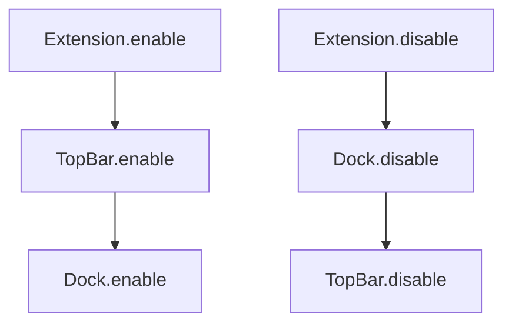

# Architecture

[`extension.js`](../extension.js) owns the lifecycle. Each shell surface is a feature module. Features do not import each other. Shared helpers live in `lib/`.

Create these files when the first feature needs them. Do not create empty modules ahead of that, and do not keep growing the template indicator.

```
extension.js          # construct features, enable in order, disable in reverse
features/topBar.js    # Main.panel changes
features/dock.js      # overview Dash changes
lib/patch.js          # save and restore method replacements
lib/signals.js        # connections disconnected from disable()
stylesheet.css
metadata.json
```

Preferences pages are separate. Add them when a task needs a preference, one file per page:

```
prefs.js                    # add preferences pages to the window
preferences/generalPage.js  # General preferences tab
preferences/panelPage.js    # Panel preferences tab
preferences/dockPage.js     # Dock preferences tab
```

## Feature shape

A feature is a plain class. It is not a `GObject` unless it is itself an actor. Actors inside a feature still use `GObject.registerClass`, as described in [`coding-practices.md`](coding-practices.md).

```javascript
export class TopBar {
    constructor(extension) {
        this._extension = extension;
        this._signals = new SignalTracker();
        this._patches = new PatchSet();
    }

    enable() {
        // Change Main.panel here.
    }

    disable() {
        // Safe when enable() did not finish. Safe when called twice.
        this._signals.disconnectAll();
        this._patches.restoreAll();
    }
}
```

`constructor` receives the `Extension` instance so the feature can call `extension.getLogger()` and, later, read settings. It does not receive `Main` objects to cache. Look up `Main.panel` and `Main.overview` inside `enable()`, because those objects exist for the session that is enabling the extension.

## extension.js

Register a feature before calling `enable()` on it. If `enable()` throws, GNOME Shell still calls `Extension.disable()`, and the feature must be in the list so it can clean up.

```javascript
import {TopBar} from './features/topBar.js';
import {Dock} from './features/dock.js';

export default class BetterGnomeShellExtension extends Extension {
    enable() {
        this._features = [];

        for (const Feature of [TopBar, Dock]) {
            const feature = new Feature(this);
            this._features.push(feature);
            feature.enable();
        }
    }

    disable() {
        const features = this._features ?? [];

        for (let i = features.length - 1; i >= 0; i--)
            features[i].disable();

        this._features = null;
    }
}
```

Enable order is top bar, then dock. Disable order is dock, then top bar. Features must not import each other or call each other.



## Surfaces

- Top bar work goes in `features/topBar.js` and changes `Main.panel`.
- Dock work goes in `features/dock.js` and changes the stock overview Dash, `Main.overview.dash`.

Do not build a persistent on-screen dock, and do not integrate with Dash to Dock, unless the task explicitly asks for a persistent dock.

A third surface gets its own file under `features/`. Do not put it in `extension.js` or inside another feature.

## Shared code

`lib/patch.js` and `lib/signals.js` hold the helpers from [`patterns.md`](patterns.md). Add another `lib/` module only when two features need the same helper. Do not put feature behavior in `lib/`.

## Settings

Do not add `schemas/` or `prefs.js` until a task needs a user preference.

When a task does:

- Set `"settings-schema": "org.gnome.shell.extensions.better-gnome-shell"` in [`metadata.json`](../metadata.json). The schema id is that same string.
- [`extension.js`](../extension.js) is the only place that calls `this.getSettings()`.
- Pass that `Gio.Settings` object into the features that read it.
- Disconnect settings signals in `disable()` through the feature's signal tracker.

### Preferences pages

`prefs.js` stays at the extension root because GNOME loads that file by name. It only owns `BetterGnomeShellPreferences`: call `this.getSettings()` and add pages, in order, from `fillPreferencesWindow()`.

Each preferences tab is a named export in its own file under `preferences/`. The file name is `camelCase.js` and matches the class (`generalPage.js` exports `GeneralPage`). Do not define a page class in `prefs.js`, and do not put a second page class in a file that already exports one.

```javascript
import {DockPage} from './preferences/dockPage.js';
import {GeneralPage} from './preferences/generalPage.js';
import {PanelPage} from './preferences/panelPage.js';

export default class BetterGnomeShellPreferences extends ExtensionPreferences {
    fillPreferencesWindow(window) {
        const settings = this.getSettings();

        window.add(new GeneralPage());
        window.add(new PanelPage(settings));
        window.add(new DockPage(settings));
    }
}
```

A new tab gets a new file under `preferences/`. `prefs.js` imports that class and adds it to the window.

A subpage follows the same rule. Put it in its own file under `preferences/`, named for that subpage. The parent page imports it and adds it. A subpage does not import a sibling page. When two pages need the same helper, move that helper to its own file under `preferences/`.

## Session mode

Leave the default user session. Do not add `unlock-dialog` or other `session-modes` in [`metadata.json`](../metadata.json) unless the task says the feature must run on the lock screen. The panel on the lock screen is a different object, and a feature written for the user session will not restore it correctly.
